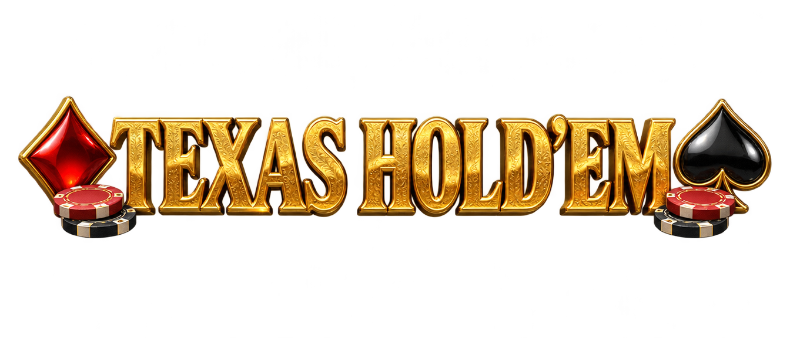
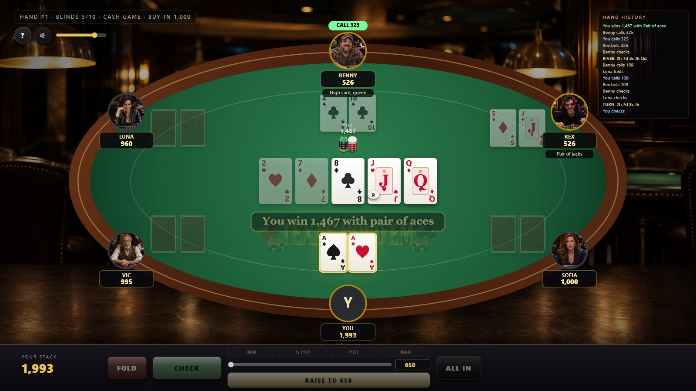
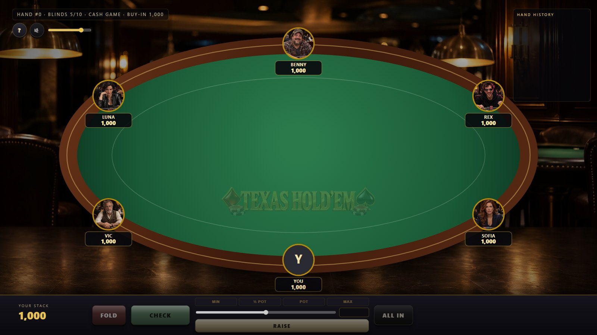
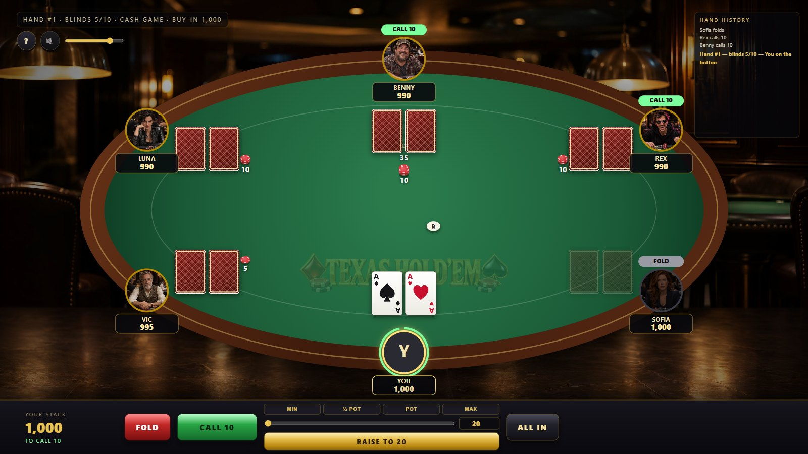
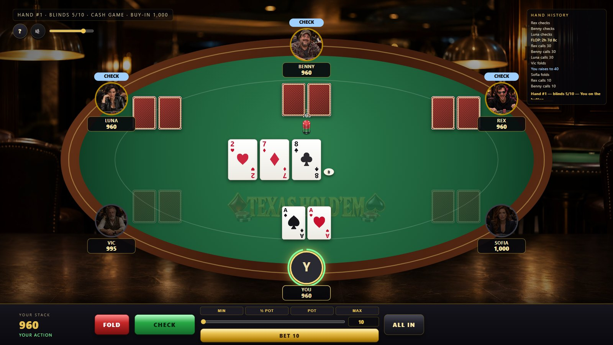
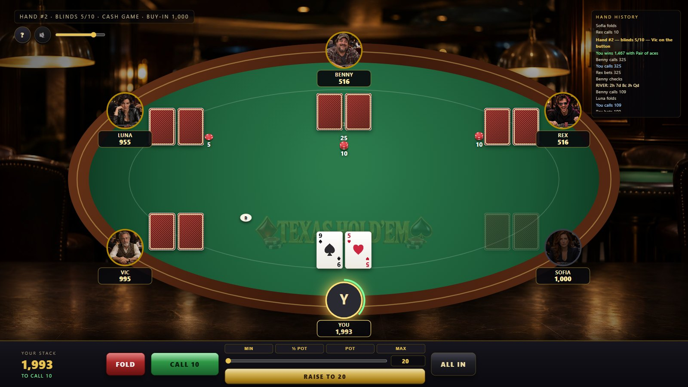
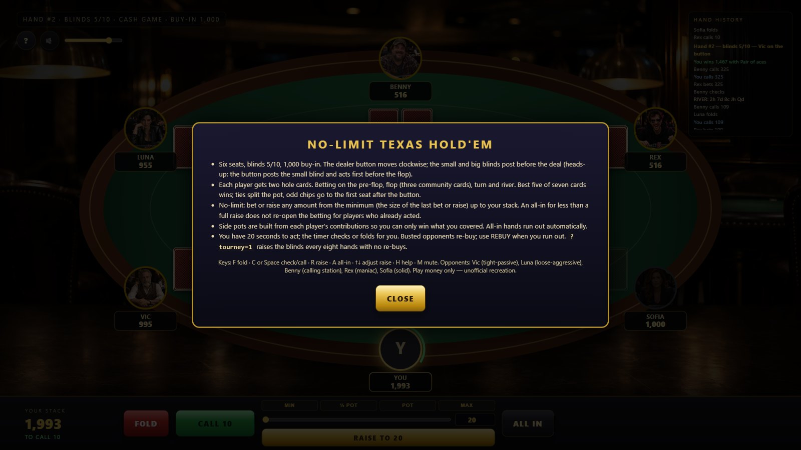

<div align="center">



### No-Limit Texas Hold'em at a six-handed table against five AI personalities




</div>

Plain HTML5 Canvas, Web Audio and vanilla JavaScript. No frameworks, no build
step, no server. A tested rules engine (blinds, minimum raises, all-ins that do
not re-open action, side pots, run-outs, best-five-of-seven showdowns, split
pots), five opponents who think in equity and pot odds, and a table that deals,
flips and pushes chips like the real thing.

> Unofficial recreation for entertainment only. Play money, no real wagering.

---

## Contents

1. [Features](#features)
2. [Platforms](#platforms)
3. [Installation](#installation)
4. [Configuration reference](#configuration-reference)
5. [User guide](#user-guide)
6. [Keyboard shortcuts](#keyboard-shortcuts)
7. [Known limitations](#known-limitations)
8. [Project layout](#project-layout)
9. [Development](#development)

---

## Features

**Rules**

* Six seats, blinds 5/10, 1,000 buy-in cash game (or `?tourney=1`: blinds rise
  every eight hands, busted players are out)
* Button and blinds rotate correctly, including heads-up (button posts the
  small blind and acts first pre-flop, big blind acts first after the flop)
* Four betting rounds with check / call / bet / raise / fold / all-in, the
  minimum-raise rule, and the short-all-in rule (an all-in for less than a full
  raise does not re-open the betting for players who already acted)
* Side pots built from each player's contributions; uncalled chips return;
  pots awarded to the best eligible hand, ties split with odd chips to the
  first seat after the button
* Automatic run-outs when no more betting is possible, showdown with every
  live hand revealed and named ("Full house, kings over tens"), uncontested
  pots taken without showing
* Hand history feed, action timer (20 s, then auto check/fold), re-buys for
  busted players, hand counter and blind level

**Opponents**

| Seat | Style | How it plays |
| --- | --- | --- |
| Vic | tight-passive | needs real equity, rarely raises, almost never bluffs |
| Luna | loose-aggressive | calls light, bets and raises often, bluffs about a fifth of the time |
| Benny | calling station | hates folding, calls down with anything half-decent |
| Rex | maniac | raises constantly, shoves short, bluffs a third of the time |
| Sofia | solid | balanced equity-driven play with occasional semi-bluffs |

Each decision runs a Monte-Carlo equity estimate of the bot's hand against the
number of live opponents (220–420 trials, more after the flop), compares it with
the pot odds, adds position and a pre-flop hand-class bonus, and applies the
personality's thresholds, sizing and bluff rate. Bots think for 0.7–2.5 seconds.

**Presentation**

* Oval table with a mahogany rail and radial-lit felt in a dim poker room,
  photoreal opponent portraits, dealer button, pot and bet chip stacks that
  break down into denominations
* Cards fly from the shoe to each seat, community cards flip over, opponents'
  cards flip at showdown, chips fly to the bet spots, sweep into the pot and
  out to the winner; the winning five cards glow while the rest dim
* Action tags over the avatars, a pulsing turn ring with a countdown arc on
  your seat, a winner banner under the board

**Sound (synthesized, plus eight generated dealer lines)**

Card swishes and flips, chip clinks and slides, the check knock, a fold flick,
an all-in sting, win chimes, your-turn alert, timer ticks, room ambience, and
a dealer voice calling "Shuffle up and deal", the streets, "All in!" and "We
have a winner".

---

## Platforms

| Platform | Status | Notes |
| --- | --- | --- |
| Chrome / Edge (desktop) | Tested | Headless Chrome runs the smoke test and screenshots |
| Firefox (desktop) | Expected to work | Standard Canvas 2D / Web Audio only |
| Safari (macOS / iOS) | Expected to work | Audio starts after the first tap |
| Tablets | Playable | 1920 × 1080 scene scales to fit; landscape recommended |
| Offline / `file://` | Works | Voice clips need HTTP; everything else is local |

Requirements: a browser with Canvas 2D, Web Audio and ES2020. Node.js 22+ only
for the test tools.

---

## Installation

1. **Get the files.** Keep `assets/`, `css/` and `js/` next to `index.html`.
2. **Serve it (recommended):**

   ```bash
   python -m http.server 8768
   ```

   or double-click `start.cmd` on Windows, then open <http://localhost:8768/>.
3. **Or open `index.html` directly** from disk.
4. **Click once** on the splash screen to take your seat (this also unlocks
   audio). The first hand is dealt a second later.
5. Optional URL parameters: `?tourney=1` tournament blinds, `?mute=1` silent,
   `?fast=1` short delays, `?auto=1` the AI plays your seat.

### Configuration reference

| Setting | File | Default | Meaning |
| --- | --- | --- | --- |
| seat list (`name`, `ai`) | `js/game.js` | Vic, Luna, Benny, Rex, Sofia | Opponents and their personality keys |
| `buyIn` | `js/game.js` | `1000` | Starting stack and re-buy amount |
| `sb`, `bb` | `js/game.js` | `5`, `10` | Blinds (cash game) |
| `LEVELS` | `js/game.js` | 5/10 … 200/400 | Tournament blind schedule, one level per 8 hands |
| `turnLimit` | `js/game.js` | `20` s | Your action timer |
| `PERSONALITIES` | `js/ai.js` | five profiles | `fold` (equity shift to continue), `aggr`, `bluff`, `call`, `sizing`, `iters` |
| `SEAT_ANGLES`, `CARD` | `js/render.js` | 6 seats, 74 × 104 / 92 × 128 | Table geometry and card sizes |
| `poker.volume`, `poker.muted` | browser `localStorage` | `0.8`, `0` | Remembered volume and mute |

---

## User guide

### Dealing



The button (the white **D**) moves clockwise each hand; the small and big
blinds post automatically. Cards fly from the shoe to every seat, two rounds,
starting left of the button.

### Your action



When the gold ring pulses around your seat it is your turn. The bar shows your
stack and what it costs to call. **FOLD**, **CHECK** / **CALL n**, or set a
raise with the slider, the amount box or the presets (**MIN**, **½ POT**,
**POT**, **MAX**) and press **RAISE TO n** (it reads **BET n** when nobody has
bet yet). **ALL IN** pushes everything. The countdown arc shows the remaining
time; at zero the game checks or folds for you.

### The streets



After each round the bets slide into the pot and the next street flips over.
Opponents' actions appear as tags above their avatars and in the hand-history
feed on the right.

### Showdown


Live hands are revealed, every player's hand is named under their plate, the
five cards that win glow, the banner says who won what with which hand, and
the pot flies to the winner. Side pots are awarded one by one.

### Between hands



Busted opponents re-buy automatically; when you run out a **REBUY 1,000**
button appears. Press **?** for the rules.



---

## Keyboard shortcuts

| Key | Action |
| --- | --- |
| `F` | Fold |
| `C` or `Space` | Check / call |
| `R` | Bet / raise to the slider amount |
| `↑` / `↓` | Raise amount up / down one big blind |
| `A` | All in |
| `H` | Help · `M` mute · `Esc` close help |

---

## Known limitations

* Opponents never slow-play deliberately and do not model you; they are
  equity-and-odds players with personality thresholds, beatable with patience.
* No chat, no hand-for-hand replay, no multi-table; one cash table or one
  tournament table at a time.
* Your seat has no portrait (a gold **Y** badge); portraits are AI-generated
  interpretations.
* Voice clips are fetched over HTTP, so none play from `file://`.
* Play money only; no real-money functionality of any kind, by design.

---

## Project layout

```
poker/
├── index.html            page: canvas, HUD, history, action bar, help, splash
├── start.cmd             Windows launcher (local server + browser)
├── css/style.css         HUD, action bar, chips, overlays
├── js/
│   ├── cards.js          deck, 5–7 card evaluator, best five, hand names (node + browser)
│   ├── equity.js         Monte-Carlo equity vs N opponents (node + browser)
│   ├── engine.js         rules state machine: blinds, betting, side pots, showdown (node + browser)
│   ├── ai.js             five personalities, equity/pot-odds decisions (node + browser)
│   ├── audio.js          shared Web Audio synthesizer engine
│   ├── audio-poker.js    table sounds and voice clips
│   ├── render.js         table, seats, cards, chips, animations, banner
│   ├── game.js           pacing: deals, AI think time, timer, run-outs, re-buys, levels
│   ├── ui.js             action bar, slider and presets, history feed, help, keys
│   └── main.js           bootstrap, frame loop, test hooks
├── assets/
│   ├── portraits/*.jpg   five generated opponents
│   ├── bg/room.jpg       poker room backdrop
│   ├── logo.png          title logo
│   └── audio/*.mp3       eight generated dealer lines
├── docs/
│   ├── index.html        GitHub Pages landing page
│   └── screenshots/      images used here and on the landing page
└── tools/
    ├── eval-test.js      evaluator unit tests (33 checks incl. 4,000 random hands vs combo max)
    ├── equity-check.js   exact enumeration + Monte-Carlo equities vs known values
    ├── engine-test.js    blinds, min-raise, short all-in, side pots, splits, folds (30 checks)
    ├── cdp.mjs           shared headless-Chrome helper (no dependencies)
    ├── smoke.mjs         plays hands in headless Chrome, checks chip conservation, forced deck
    ├── screenshots.mjs   documentation screenshots
    └── pngalpha.py       alpha-channel report for PNG assets
```

---

## Development

**Run locally:** `python -m http.server 8768` (or `start.cmd`). No build step.

**Logic tests (node):**

```bash
node tools/eval-test.js
node tools/engine-test.js
node tools/equity-check.js
```

The evaluator test includes category frequencies over 60,000 random seven-card
hands against the published odds and checks that the direct evaluator agrees
with the best of all 21 five-card combinations on 4,000 random hands. The
equity check enumerates all 1,712,304 boards for AA vs KK (81.9 %), AKs vs QQ
and AA vs 72o, then compares Monte-Carlo estimates against random hands.

**Headless smoke test:** `node tools/smoke.mjs` launches Chrome, lets the AI
play your seat for a few minutes of virtual time (chips must be conserved,
hands must reach named showdowns), then plays a scripted hand with a forced
deck (you hold A♠ A♥, call down, and must win at showdown), and fails on any
console error.

**Screenshots:** `node tools/screenshots.mjs` regenerates `docs/screenshots/`.

**Test hooks in the page:** `PK.step(seconds)` advances the virtual clock;
`PK.game.forceDeck('2c Ah 4c …')` queues a deck in deal order (first card to
the seat left of the button, second round, then burn/flop/burn/turn/burn/river);
`PK.game.act('raise', 40)` acts for you; `PK.game.engine.history` holds the
hands.

**Publish:** enable GitHub Pages for the repository root; the game is served at
`/` and the landing page at `/docs/`.
